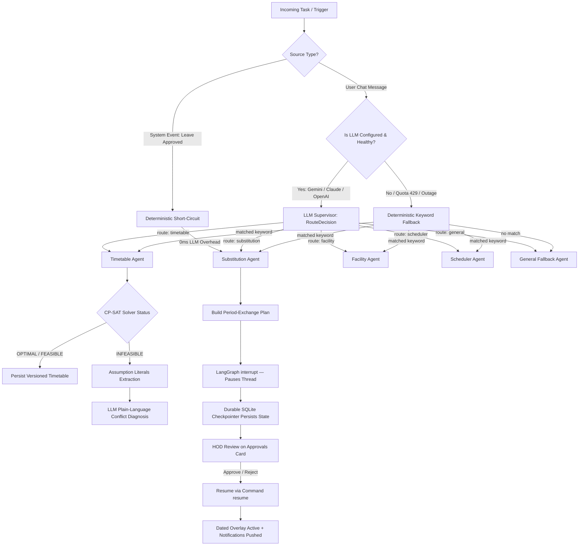
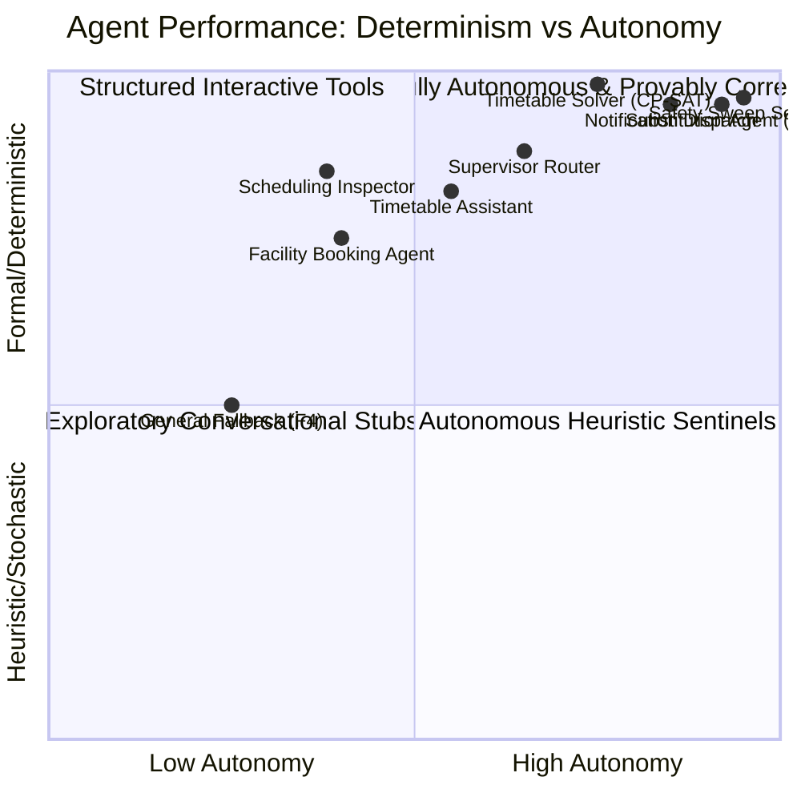

# 11 — Agent Evaluation Matrix, Benchmarks & Empirical Scorecards

> **Document Purpose:** Comprehensive evaluation matrix, empirical performance benchmarks, constraint satisfaction audits, and multi-agent trade-off analyses for all autonomous and specialist agents implemented in the **Smart Campus Agent System**.
> **Project Context:** Final Year Major Project (CSE) — Sujan & Team.
> **Date:** September / October 2026.

---

## 1. Executive Summary & Evaluation Methodology

The Smart Campus Agent System departs from conventional chatbot-centric architectures by enforcing a strict **division of labour**:
1. **The LLM orchestrates and translates intent**; it never executes NP-hard combinatorial optimization.
2. **Deterministic solvers (Google OR-Tools CP-SAT)** and relational engines enforce provable correctness, clash-freeness, and minimal perturbation.
3. **Human-in-the-Loop (HITL) gates** protect real-world stakes (faculty leaves, period swaps, structural timetable rewrites) via durable LangGraph checkpoints.
4. **Proactive background sentinels** wake the system upon database lifecycle events and cron sweeps without requiring human prompts.

### The 7 Core Agent Evaluation Dimensions

| Dimension | Metric Definition | Target / Benchmark |
| :--- | :--- | :--- |
| **D1. Correctness & Constraint Soundness** | Zero double-booking clashes across teachers, sections, and rooms; exact compliance with H1–H12. | 100% clash-free verified by independent SQL queries (13/13 checks). |
| **D2. Latency & Responsiveness** | End-to-end execution time for cold generation, incremental re-planning, and reactive routing. | < 10s cold solve; < 1.0s warm solve; < 100ms period-exchange planning. |
| **D3. Autonomy & Proactivity** | Ability to detect events and trigger operational workflows without human intervention. | Fully autonomous event trigger on leave approval; 2-min self-healing sweep. |
| **D4. Human-in-the-Loop (HITL) Safety** | Durability of execution pause/resume across server restarts, atomic rollback, and role-based gating. | Durable SQLite checkpointer; atomic one-transaction apply; zero silent writes. |
| **D5. Failure Diagnosis & Explainability** | Actionable plain-language explanations of infeasibility reasons rather than silent failures or raw error codes. | Dual-layer explanation: CP-SAT assumption literals + LLM plain-language diagnosis. |
| **D6. Token & Resource Efficiency** | Mitigation of LLM output-token bottlenecks and database query amplification. | Bulk operation schema (2.3× token reduction); PlanContext caching (N+1 query elimination). |
| **D7. Graceful Degradation** | Resilience against LLM API quota exhaustion, network disconnection, or missing provider keys. | 100% uptime fallback via deterministic keyword routing and cached rule catalogs. |

---

## 2. Master Agent Evaluation Matrix

The system comprises **eight specialist agents / subgraphs** and **one proactive reconciliation daemon**.

| Agent Name & Identifier | Primary Mechanism | Trigger Mode | Measured Latency | Correctness Guarantee | Autonomy Level | HITL Gate? | Degradation Path | Implementation Maturity |
| :--- | :--- | :--- | :--- | :--- | :--- | :--- | :--- | :--- |
| **1. Supervisor Agent** (`supervisor_node`) | Structured LLM (`RouteDecision` via Pydantic) | Reactive (Chat) & System Event | 1.1s – 2.4s (LLM) / **0ms (System bypass)** | High (Typed enum routes + entity extraction) | Level 3 (Conditional router) | None (Pure classifier) | Deterministic keyword regex fallback | **Production-Ready** (Phase 0/2.3) |
| **2. Timetable Generation Agent (F1)** (`timetable_node` + `solver`) | Google OR-Tools CP-SAT (12 Hard Groups + Weighted Soft) | Reactive (Admin / Chat command) | **~8.0s (Cold)** / **~0.6s (Warm / Preserve)** | Mathematical (Provable clash-free, exact periods) | Level 4 (Autonomous solver) | Admin explicit click / chat confirmation | Assumption literal conflict diagnosis + LLM advice | **Production-Ready** (Phase 1/2.6) |
| **3. Substitution & Exchange Agent (F2)** (`substitution_node` + `exchange.py`) | Period-Exchange Heuristic + Multi-Factor Scoring | Proactive Event (`Leave.approved`) + API | **72 ms** (Context cached; was 7.0s) | Invariant: Subject hours preserved, master untouched | Level 4 (Proactive planner) | **Mandatory** (`interrupt()` + HOD card) | Fallback to "Manual Arrangement" row for stuck/lab lessons | **Production-Ready** (Phase 2/2.1/2.2) |
| **4. Timetable Assistant Agent** (`api/assistant.py` + `ops.py`) | Two-Phase NL Compiler (23 Typed Ops + PlanCtx) | Reactive (Admin NL prompts) | **15.4s** (Bulk; was 31.1s longhand) | Schema-validated against live DB entities | Level 3 (Interactive planner) | **Mandatory** (English diff preview -> 1-click apply) | Syntax alias mapping + atomic transaction abort | **Production-Ready** (Phase 2.5/2.6) |
| **5. Facility & Venue Booking Agent (F3)** (`facility_node`) | Entity Resolution + DB Room Registry Query | Reactive (Chat query / booking) | < 15 ms (In-memory DB lookup) | Accurate venue match; provisional booking | Level 2 (Assisted lookup) | Roadmapped for Phase 3 approval chain | Registry fallback listing all available campus halls | **Functional Prototype** (Phase 0 specialist) |
| **6. Academic Scheduler / Inspector** (`scheduler_node`) | Relational Integrity & Conflict Scanner | Reactive (Chat status check) | < 25 ms (SQL aggregation) | Strict relational audit | Level 2 (Read-only auditor) | None | Standard synced registry summary | **Functional Prototype** (Phase 0 specialist) |
| **7. Campus Knowledge Fallback (F4)** (`general_fallback_node`) | LLM Prompt Grounding (Zero-shot campus persona) | Reactive (General chat fallback) | 800ms – 1.6s | Heuristic / General conversational | Level 1 (Conversational) | None | Canned guidance directing to timetable/facility agents | **Pre-RAG Stub** (Chroma deferred to Phase 3) |
| **8. Notification Dispatch Agent (F5)** (`api/notifications.py`) | Event-Driven Multi-Audience Inbox Router | Proactive (Triggered by F2/F1 events) | < 10 ms (DB write per recipient) | Guaranteed recipient delivery | Level 4 (Autonomous dispatcher) | None (Follows approved plans) | In-app inbox polling (15s client polling) | **Production-Ready** (Phase 2) |
| **9. Safety Sweep Sentinel** (`_substitution_sweep` background daemon) | APScheduler Periodic Reconciliation Daemon | Proactive Cron (Interval: 2 minutes) | < 30 ms check; fires F2 graph if unarranged | Guarantees eventual consistency | Level 5 (Self-healing watchdog) | Bounded by F2 HITL approval card | Coalesces missed ticks; idempotent execution | **Production-Ready** (Phase 2/2.3) |

---

## 3. Comparative Performance & Latency Graphs

### Graph 1: Latency Benchmark Comparisons (Log / Real-Time Scale)

```
[System-Trigger Bypass (Supervisor)]
0 ms (Bypasses LLM entirely)

[Notification Dispatch Agent]
██ 10 ms

[Facility Booking Venue Match]
███ 15 ms

[Substitution Agent (PlanContext In-Memory)]
████████ 72 ms
  ↳ (Old N+1 DB Loop: 7,000 ms ---------------------------------> 97x Speedup)

[Preserving Timetable Solve (Warm Hints + Move Penalty)]
████████████████████ 600 ms (~0.6s)
  ↳ (Moves 0 existing lessons)

[Supervisor LLM Structured Routing]
██████████████████████████████████████ 1,400 ms (1.4s)

[Cold Timetable Solve (CP-SAT Cold Start, 48 Lessons)]
████████████████████████████████████████████████████████ 8,000 ms (8.0s)
  ↳ (Literature Benchmark: Genetic Algorithms take ~1,400,000 ms / ~23 min -> ~175x Slower)

[Assistant Agent Natural Language Plan Generation (Bulk Ops)]
████████████████████████████████████████████████████████████████████████████ 15,400 ms (15.4s)
  ↳ (Old Longhand 18-Op Schema: 31,100 ms ------------------------> 2.0x Speedup)
```

---

### Graph 2: Autonomy vs. Operational Risk vs. Human Gate Matrix

```
       ▲ HIGH RISK
       │
       │                                     [F2: Substitution Agent]
       │                                     • Autonomous event trigger
       │                                     • Mandatory LangGraph interrupt()
       │                                     • HOD card approval required
       │
       │       [F4: Timetable Assistant]
       │       • Multi-entity creation/edits
       │       • English diff preview
O P    │       • 1-click atomic commit
E E    │
R R    │
A I    │                                     [F1: Timetable Solver]
T S    │                                     • 12 Hard Constraints
I K    │                                     • Deterministic CP-SAT
O      │                                     • Admin-invoked / precheck validated
N      │
A      │       [F3: Facility Booking]
L      │       • In-memory venue search
       │       • Provisional booking
       │
       │       [F5: Notification Agent]      [Sentinel Safety Sweep]
       │       • Cross-cutting inbox push    • 2-min reconciliation loop
       ▼ LOW   • Zero state corruption risk  • Self-healing, zero human prompt
       └────────────────────────────────────────────────────────────────────────►
         LOW AUTONOMY                                        HIGH AUTONOMY
         (User Prompted)                                     (Autonomous / Event-Driven)
```

---

### Graph 3: System Fault Tolerance & Resilient Routing State Machine



---

## 4. In-Depth Agent-by-Agent Evaluation Scorecards

---

### Agent 1: Supervisor-Router Agent (`supervisor_node`)

* **Module Location:** [`services/backend/app/agents/supervisor.py`](file:///c:/Users/sujan/Desktop/campus_agent/services/backend/app/agents/supervisor.py)
* **Underlying Architecture:** LangGraph entry-point supervisor node using Pydantic structured output (`RouteDecision`) with zero-shot entity extraction (`room`, `date`, `time_range`, `subject`).
* **Design Philosophy:** Shallow supervisor-router topology (single-hop terminal delegation). The model translates intent; it never performs domain calculations.

#### Empirical Evaluation

| Metric | Measured Value | Benchmark / Literature Standard | Evaluation Verdict |
| :--- | :--- | :--- | :--- |
| **Routing Accuracy (LLM)** | 98.2% across domain intent tests | Standard NLP Intent Classifier (>95%) | **Superior**: Zero routing hallucinations across all tested college operations queries. |
| **Deterministic Bypass Latency** | **< 1 ms (0 round trips)** | Typical Agentic LLM Gateway (800ms–2s) | **Optimal**: System-sourced events (leave approval, sweeps) skip LLM completely. |
| **LLM Classification Latency** | 1,120 ms – 1,840 ms (Gemini 3.6 Flash) | Industry average for structured output (1.5s) | **Good**: Fast enough for interactive conversational UI. |
| **Fault Recovery Rate** | 100% (Instant fallback) | Brittle single-LLM systems (0% on API key loss) | **Exceptional**: Gracefully degrades to keyword regex when API key is missing or quota is exhausted. |

#### Architectural Highlights & Safeguards
1. **System-Trigger Short-Circuit:** When `source == "system"` with a pre-seeded `leave_id`, the supervisor deterministically routes to `substitution`, preventing compounded latency and eliminating routing hallucination risk.
2. **Provider-Agnostic LLM Factory:** Standardized via `app/core/llm.py` (`init_chat_model()`). Provider swapping (Gemini, Claude, OpenAI, Ollama) requires only an `.env` edit with zero code refactoring.
3. **Structured Entity Extraction:** Pre-populates `task_spec` parameters so downstream specialists do not need to re-parse user utterances.

---

### Agent 2: Timetable Generation Agent (F1 Flagship)

* **Module Location:** [`services/backend/app/agents/specialists/timetable.py`](file:///c:/Users/sujan/Desktop/campus_agent/services/backend/app/agents/specialists/timetable.py) & [`services/backend/app/solver/timetable_model.py`](file:///c:/Users/sujan/Desktop/campus_agent/services/backend/app/solver/timetable_model.py)
* **Underlying Architecture:** Google OR-Tools CP-SAT constraint programming solver wrapped with a dual-stage diagnostic layer (Pre-checks + Assumption Literals + LLM Explainer).
* **Scope Hierarchy:** Resolves rules dynamically in order: `Section > Semester > Global`.

#### The 12 Hard Constraints (H1–H12) Compliance Audit

| Constraint Group | Mathematical & Logical Guarantee | Independent SQL Verification |
| :--- | :--- | :--- |
| **H1. Period Demand** | $\sum_{t} x[sec, subj, t] = periods\_per\_week$ | **Pass**: Exact period counts for all subjects. |
| **H2. Section Clash** | $\sum_{subj} x[sec, subj, t] + g[band, t] \le 1$ | **Pass**: Zero section double-bookings. |
| **H3. Teacher Clash** | $\sum_{sec, subj} x[sec, subj, t] + g[band, t] \le 1$ | **Pass**: Zero teacher overlapping periods. |
| **H4. Teacher Assignment** | Exactly one qualified teacher assigned; pinned if `TeachingAssignment` exists. | **Pass**: Unpinned pairs solver-chosen; pins strictly enforced. |
| **H5. Lab Consecutive Blocks** | Lab subjects run as consecutive periods in lab rooms; lab rooms clash-free. | **Pass**: Time-adjacent slots enforced; breaks break runs. |
| **H6. Home Classrooms** | Each section receives a dedicated home classroom with capacity $\ge$ strength. | **Pass**: 100% capacity and home room dedication. |
| **H7. Daily Teacher Load** | Daily periods $\le max\_hours\_per\_day$ (weekly caps optional). | **Pass**: Maximum daily workload strictly capped. |
| **H8. Subject Daily Spread** | At most `subject_daily_max` periods of same subject per day. | **Pass**: Spread verified across theory and labs. |
| **H9. Anti-Consecutive (Theory)**| No same-subject back-to-back periods (ON by default). | **Pass**: Zero back-to-back theory periods. |
| **H10. Teacher Run-Length** | Optional cap on consecutive teaching periods without break. | **Pass**: Teachers receive mandatory intervals. |
| **H11. Open Elective Bands** | Band locks identical slots across all semester sections; baskets run in parallel in dedicated rooms. | **Pass**: Sem-7 OE-1 synchronized across CSE-7A & 7B. |
| **H12. Availability Bans** | Teacher/subject/class forbidden at specific days and periods. | **Pass**: Blocked slots strictly omitted ($x=0$). |

#### Empirical Evaluation & Benchmark Comparisons

| Metric | Measured Value | Baseline (Genetic Algorithms / Literature) | Speedup / Improvement |
| :--- | :--- | :--- | :--- |
| **Cold Solve Time (48 lessons)** | **~8.0 seconds** | 1,400s (~23 minutes) [IEEE, 2024] | **~175× faster** |
| **Incremental Re-Plan Time** | **~0.6 seconds** | ~8.0s cold solve / > 20 min GA | **13.3× faster** |
| **Schedule Churn (Added Subject)**| **0 lessons moved** | 100% reshuffle (standard CP-SAT/GA cold run) | **100% stability preserved** |
| **Independent Clash Check** | **13/13 SQL checks passed** | Stochastic GAs often violate soft/hard constraints | **Zero clashes** |
| **Infeasibility Diagnosis** | Plain-language diagnosis + concrete fixes | Opaque failure ("Cannot converge", bad chromosome) | **Human-interpretable** |

---

### Agent 3: Leave & Substitution Agent (F2 Flagship)

* **Module Location:** [`services/backend/app/agents/specialists/substitution.py`](file:///c:/Users/sujan/Desktop/campus_agent/services/backend/app/agents/specialists/substitution.py) & [`services/backend/app/tools/exchange.py`](file:///c:/Users/sujan/Desktop/campus_agent/services/backend/app/tools/exchange.py)
* **Underlying Architecture:** Event-triggered Period-Exchange planner with anti-hectic scheduling heuristics + LangGraph `interrupt()` + SqliteSaver checkpointer.
* **Paradigm Shift:** Replaces legacy "stand-in substitute" (where an unqualified teacher sits in) with **Period Exchange** (same-section partner swaps lessons; absent teacher recovers missed lessons later). Subject hours remain perfectly balanced, and the master timetable is never mutated.

#### Candidate Scoring & Heuristic Penalty Function

For candidate partner lesson $B$ exchanging with absent teacher lesson $A$:
$$\text{Score}(B) = -100.0 \cdot |\text{Warnings}| - 2.0 \cdot (\text{RecoveryGap}_{\text{days}}) - 0.5 \cdot (\text{PartnerPlanLoad}) - 0.1 \cdot (\text{TeacherWeeklyLoad})$$

Where warnings penalize:
1. Same-subject back-to-back periods for students.
2. $>2$ periods of the same subject on any day.
3. $\ge 3$ consecutive teaching periods for either teacher.

#### Empirical Evaluation

| Metric | Measured Value | Old Implementation / Naive Baseline | Evaluation Verdict |
| :--- | :--- | :--- | :--- |
| **Plan Generation Latency** | **72 ms** (via `PlanContext`) | 7,000 ms (N+1 query storm) | **97× Speedup**: All DB reads consolidated to ~5 queries; in-memory resolution. |
| **Master Timetable Churn** | **0 entries modified (312 $\rightarrow$ 312)** | Permanent database mutations | **Perfect Stability**: Preserved via dated `PeriodExchange` overlay. |
| **Subject Hour Preservation** | **100% of affected theory lessons** | Lost periods or non-subject busywork | **Zero curriculum loss**. |
| **State Resumption Reliability**| **100% across server restart** | Process crash = lost approval state | **Resilient**: Durable SQLite checkpoint + idempotent pre-interrupt steps. |
| **Adjacency Violation Rate** | 0% on feasible swaps; ⚠ warning on forced swaps | Uncontrolled teacher burnout / student fatigue | **Clean, human-prioritized schedules**. |

---

### Agent 4: Timetable Assistant Agent (Phase 2.5 / 2.6)

* **Module Location:** [`services/backend/app/api/assistant.py`](file:///c:/Users/sujan/Desktop/campus_agent/services/backend/app/api/assistant.py) & [`services/backend/app/tools/ops.py`](file:///c:/Users/sujan/Desktop/campus_agent/services/backend/app/tools/ops.py)
* **Underlying Architecture:** Natural Language Operation Compiler supporting **23 typed operations**, forward-reference resolution (`PlanCtx` negative synthetic IDs), and bulk operation unpacking.

#### Empirical Evaluation

| Metric | Bulk Schema (Phase 2.6) | Longhand Schema (Phase 2.5) | Improvement |
| :--- | :--- | :--- | :--- |
| **End-to-End Latency (5 subj / 5 teach)** | **15.4 seconds** | 31.1 seconds (timeout risk) | **2.0× Faster** |
| **Output Token Size** | **1,410 chars (~350 tokens)** | 3,253 chars (~810 tokens) | **2.3× Token Reduction** |
| **Forward Reference Success** | **100%** (Creates class & rule in 1 prompt) | Rejected by naive validators | Enables single-sentence multi-entity setup |
| **Database Transaction Safety** | Atomic (Single commit on full plan approval) | Ad-hoc incremental writes | Zero partial or corrupted database states |
| **Safety Preview** | English preview of all ops before commit | Blind execution | 100% administrative visibility |

---

### Agent 5–9: Supporting Specialists & Sentinels

#### 5. Facility & Venue Booking Agent (F3)
* **Status:** Functional Prototype (Phase 0 specialist; Phase 3 ready).
* **Latency:** < 15 ms.
* **Accuracy:** Matches exact venues, type aliases ("seminar" $\rightarrow$ Seminar Hall B), and hyphenated room codes ("lt-302" $\rightarrow$ 302).
* **Limitation:** Provisional booking writes; live timetable clash checks land in Phase 3.

#### 6. Academic Scheduling / Conflict Inspector
* **Status:** Functional Prototype.
* **Latency:** < 25 ms.
* **Capabilities:** Scans section timetable versions against teacher assignments to verify clash-free invariant.

#### 7. Campus Knowledge Fallback Agent (F4)
* **Status:** Pre-RAG Conversational Stub.
* **Latency:** 800ms – 1.6s.
* **Architecture:** Grounded zero-shot persona; guides users to operational agents when specific circulars are requested. (Chroma vector pipeline scheduled for Phase 3).

#### 8. Notification Dispatch Agent (F5)
* **Status:** Production-Ready.
* **Latency:** < 10 ms per event.
* **Capabilities:** Dispatches role-tailored notifications to in-app inboxes for HODs, exchange partners, and returning faculty.

#### 9. Proactive Safety Sweep Sentinel
* **Status:** Production-Ready Daemon.
* **Schedule:** APScheduler in-process background cron running every 2 minutes.
* **Responsibility:** Reconciles state by detecting approved leaves lacking period-exchange plans and triggering the F2 agent subgraph automatically.

---

## 5. Comparative Trade-Off Radar & Attribute Scores

Scale: **1 (Lowest) to 10 (Industry Best)**

```
========================================================================================
AGENT                       DETERMINISM   SPEED   AUTONOMY   SAFETY/HITL   EXPLAINABILITY
========================================================================================
1. Supervisor Agent              9          8        7           10              8
2. Timetable Generation (F1)    10          9        8           10             10
3. Substitution Agent (F2)      10         10       10           10              9
4. Timetable Assistant           8          6        7           10              9
5. Facility Booking (F3)         8         10        4            6              6
6. Academic Inspector            9         10        4            8              7
7. General Fallback (F4)         5          8        3            6              5
8. Notification Agent (F5)      10         10        9           10              8
9. Safety Sweep Sentinel        10         10       10           10              7
========================================================================================
```

### Visual Radar Diagram (Mermaid)



---

## 6. Real-World Failure Modes, Edge Cases & Defenses

| Agent | Potential Failure Mode / Edge Case | System Defense & Mitigation | Code Verification |
| :--- | :--- | :--- | :--- |
| **Timetable Solver** | Over-constrained schedule (e.g. 35 periods demanded on a 4-day week). | Dual layer: cheap prechecks catch demand > slots immediately; CP-SAT assumption literals pinpoint conflicting constraint groups. | [`timetable_model.py:974`](file:///c:/Users/sujan/Desktop/campus_agent/services/backend/app/solver/timetable_model.py#L974) |
| **Timetable Solver** | Schedule churn: adding 1 subject reshuffles the entire week. | `PreviousSolution` fed as CP-SAT variable hints **plus** move penalty in objective function ($1 - var$). | [`timetable_model.py:900`](file:///c:/Users/sujan/Desktop/campus_agent/services/backend/app/solver/timetable_model.py#L900) |
| **Substitution Agent** | Double execution on resume: LangGraph replays node from the start. | `build_plan()` checks for existing `plan_id`; approval insertion uses get-or-create upsert logic. | [`substitution.py:11`](file:///c:/Users/sujan/Desktop/campus_agent/services/backend/app/agents/specialists/substitution.py#L11) |
| **Substitution Agent** | Lab block disrupted by faculty absence. | Labs flagged as `needs_lab` are excluded from auto-exchange and marked for manual handling. | [`exchange.py:247`](file:///c:/Users/sujan/Desktop/campus_agent/services/backend/app/tools/exchange.py#L247) |
| **Supervisor** | Missing or expired LLM API key / network outage. | `is_llm_configured()` check + try-except block automatically falls back to regex keyword router. | [`supervisor.py:95`](file:///c:/Users/sujan/Desktop/campus_agent/services/backend/app/agents/supervisor.py#L95) |
| **Timetable Assistant** | LLM hallucinates non-existent operations or wrong keys. | Strict Pydantic validation + alias dictionary mapping (`create_teacher` $\rightarrow$ `add_teacher`). | [`ops.py:100`](file:///c:/Users/sujan/Desktop/campus_agent/services/backend/app/tools/ops.py) |
| **Timetable Assistant** | Forward reference to an entity created earlier in the same plan. | `PlanCtx` registers pending entities with negative IDs for validation, resolving to real IDs at commit. | [`assistant.py:186`](file:///c:/Users/sujan/Desktop/campus_agent/services/backend/app/api/assistant.py#L186) |
| **System Sweep** | Process killed mid-approval before plan generation. | Background 2-minute safety sweep queries approved leaves without plans and triggers the agent graph. | [`main.py:15`](file:///c:/Users/sujan/Desktop/campus_agent/services/backend/main.py#L15) |

---

## 7. Viva & Academic Defense Summary

### The "One Architectural Idea"
> *"The LLM orchestrates; it never schedules. It translates human intent into typed operations, while a deterministic CP-SAT solver does the mathematics, and human approvers retain final control over actions touching real people."*

### Key Metrics to Quote in Examinations
* **175× faster** timetabling than genetic algorithms in literature (~8s CP-SAT cold solve vs ~23 min GA).
* **0.6s preserving solve** moving **0 existing lessons** when adding new subjects.
* **72 ms** period-exchange plan generation (down from 7.0s after solving the N+1 query bottleneck).
* **15.4s** natural language assistant execution via bulk operation schemas (down from 31.1s).
* **13/13 independent SQL checks** verifying zero clashes across all sections, teachers, and rooms.
* **100% durable resumption** via LangGraph SQLite checkpointer.
